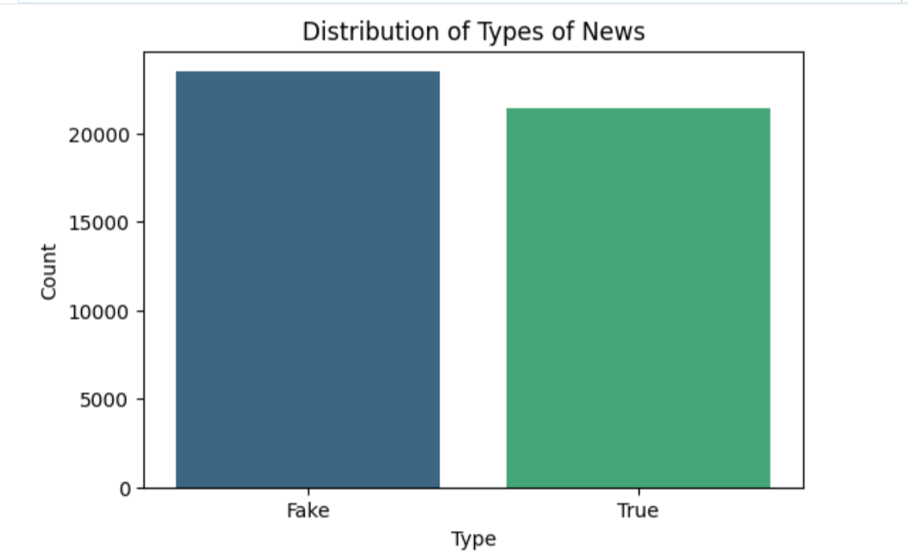
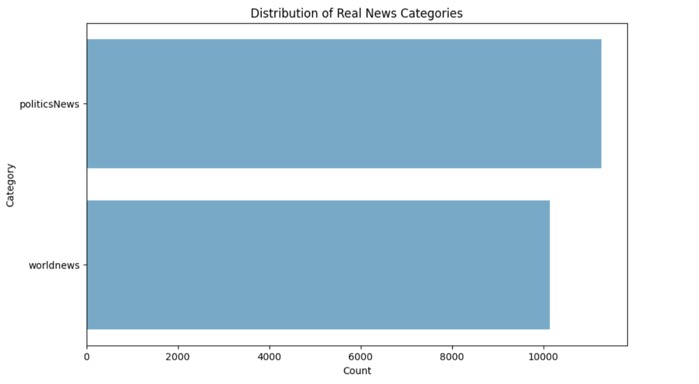
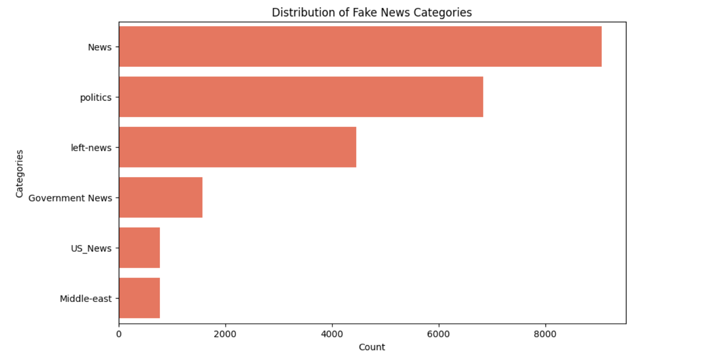
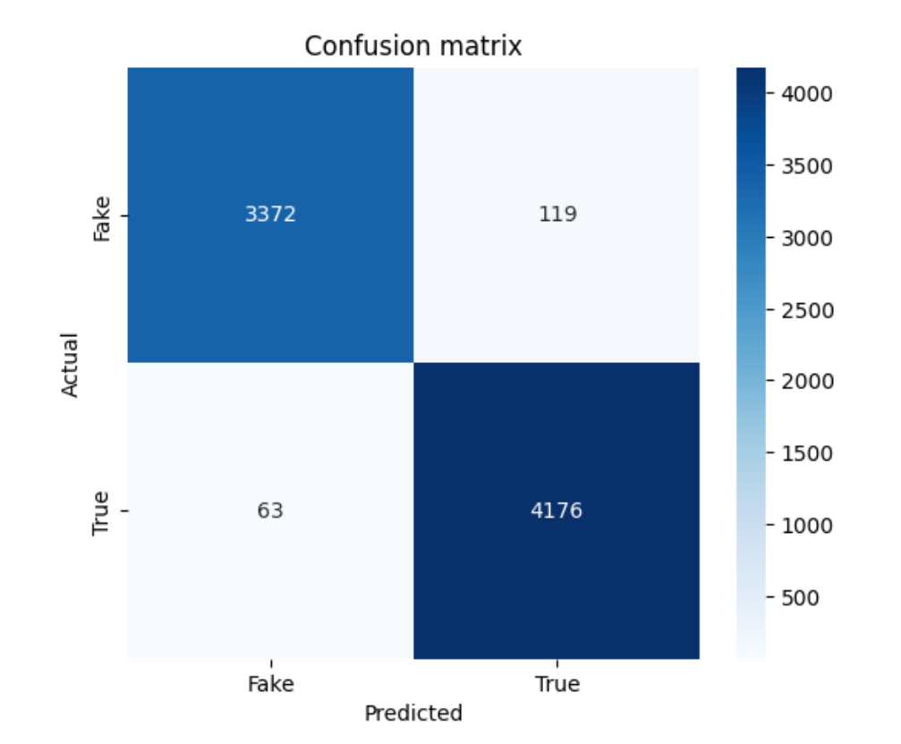

# 📰 Fake News Detection Using Machine Learning and NLP
## 📌 Project Overview
This project focuses on developing a Machine Learning model capable of identifying fake news and distinguishing misleading information from real news articles.

The project is based on a scenario in which the United States Government aims to fight the spread of online misinformation through an automated news classification system.

The proposed solution uses Natural Language Processing (NLP) techniques and Machine Learning algorithms to analyze news articles and classify them as either **Fake** or **True**.

A Logistic Regression classifier is trained using textual features extracted through TF-IDF vectorization. The final model is evaluated using classification metrics and exported in pickle format for potential integration into a Google Chrome extension.

## 🗂️ Dataset
The project uses a dataset containing two CSV files:

- **Fake.csv:** Contains articles classified as fake news.
- **True.csv:** Contains articles classified as real news.
  
The two datasets are combined into a single dataset, with an additional label identifying each article as Fake or True.

**Data Format:** CSV files.

**Main Features:**

- **Title:** News headline.
- **Text:** Full news article.
- **Subject:** News category.
- **Date:** Publication date.
- **Label:** News classification (Fake or True).

## 🎯 Project Objectives
The main objectives of the project were:

- Explore and analyze the distribution of real and fake news.
- Identify categories and topics associated with different types of news.
- Investigate recurring patterns in news headlines.
- Apply Natural Language Processing techniques to clean and prepare textual data.
- Convert textual information into numerical features using TF-IDF.
- Develop a Machine Learning classification model using Logistic Regression.
- Evaluate model performance through accuracy, precision, recall, F1-score, and confusion matrix.
- Export the trained model and TF-IDF vectorizer for future integration into a Chrome extension.

## 🛠️ Tools & Techniques
- Python
- Google Colab
- Pandas
- NumPy
- Matplotlib
- Seaborn
- NLTK
- spaCy
- Scikit-learn
- Natural Language Processing (NLP)
- Text Cleaning and Preprocessing
- Tokenization
- Stopword Removal
- Lemmatization
- TF-IDF Vectorization
- Logistic Regression
- Train-Test Split
- Classification Metrics
- Confusion Matrix
- Pickle Model Serialization

## 📂 Project Structure
The project was developed using Google Colab and organized into the following main stages:

- Dataset Import and Integration
- Exploratory Data Analysis (EDA)
- Headline Pattern Analysis
- Text Preprocessing
- Feature Extraction using TF-IDF
- Model Training
- Model Evaluation
- Model Export

## Project Workflow
**1. Data Import and Integration**

The two source CSV files were downloaded directly from the provided dataset URL.

Key activities:

- Downloading and extracting the ZIP archive.
- Importing the Fake and True news datasets.
- Adding a classification label to each dataset.
- Combining the two datasets into a single DataFrame.
- Randomly shuffling the resulting dataset.

**2. Exploratory Data Analysis (EDA)**

An initial exploratory analysis was performed to understand the dataset structure and identify relevant patterns.

Key analytical activities:

- Examining dataset dimensions and data types.
- Checking for missing values.
- Analyzing the distribution of real and fake news.
- Comparing the distribution of real news across different categories.
- Comparing the distribution of fake news across different categories.

Visualizations were created using Matplotlib and Seaborn to facilitate the interpretation of the results.

**3. Headline Pattern Analysis**

This stage investigates whether fake and real news headlines exhibit different textual characteristics.

The analysis focuses on three main features:

- **Headline Length:** Average number of characters in news headlines.
- **Exclamation Marks:** Presence of exclamation marks in headlines.
- **Uppercase Words:** Identification of words containing at least two consecutive uppercase letters.

The average values of these features were compared between real and fake news to identify potential recurring patterns.

**4. Text Preprocessing**

Natural Language Processing techniques were applied to prepare the news articles for Machine Learning.

Key preprocessing activities:

- Removing duplicate news articles.
- Cleaning news text by removing source attribution prefixes.
- Converting all text to lowercase.
- Removing numerical characters.
- Removing punctuation.
- Tokenizing the text.
- Removing English stopwords using NLTK.
- Applying lemmatization using spaCy.

These operations help reduce textual noise and standardize the input data.

**5. Feature Extraction – TF-IDF**

The cleaned news articles were converted into numerical representations using TF-IDF (Term Frequency-Inverse Document Frequency).

The vectorizer was configured with a maximum vocabulary size of 5,000 features.

The dataset was divided into:

- **Training Set:** 80% of the data.
- **Test Set:** 20% of the data.
  
The data was divided proportionally to keep the same balance of Fake and True news in both subsets.

The TF-IDF vectorizer was fitted exclusively on the training data and after applied to the test data.

**6. Model Training – Logistic Regression**

A Logistic Regression model was used to classify news as Fake or True.

The model was trained using the numerical features generated by the TF-IDF vectorizer.

Key configuration:

- **Algorithm:** Logistic Regression.
- **Maximum Iterations:** 1,000.
- **Classification Classes:** Fake and True.
- **Training/Test Split:** 80% / 20%.

The trained model was then used to classify new news articles in the test set.

**7. Model Evaluation**

The classifier was evaluated using several performance metrics:

- Accuracy
- Precision
- Recall
- F1-score
- Confusion Matrix

**Overall Accuracy:** 97.65%

**Classification Report**

| Class | Precision | Recall | F1-score | Support |
|:---:|---:|---:|---:|---:|
| Fake | 0.98 | 0.97 | 0.97 | 3,491 |
| True | 0.97 | 0.99 | 0.98 | 4,239 |
| Accuracy | - | - | 0.98 | 7,730 |
| Macro Avg | 0.98 | 0.98 | 0.98 | 7,730 |
| Weighted Avg | 0.98 | 0.98 | 0.98 | 7,730 |

The evaluation was performed on a test set containing 7,730 news articles.

**Confusion Matrix**

| Actual / Predicted | Fake | True |
|:---:|---:|---:|
| Fake | 3,372 | 119 |
| True | 63 | 4,176 |

The model correctly classified:

- 3,372 fake news articles.
- 4,176 real news articles.
- Only 182 articles were incorrectly classified.

The results demonstrate strong classification performance across both categories, with particularly high recall for real news.

**8. Model Export**

After training and evaluation, the model components were exported using Python's Pickle module.

Two files were generated:

- **fake_news_classifier.pkl:** Contains the trained Logistic Regression classifier.
- **tfidf_vectorizer.pkl:** Contains the fitted TF-IDF vectorizer.

These files save the trained model and the vocabulary used to convert new texts into numerical data.

They can be used by a development team as a starting point for integrating the classification system into a Chrome extension.

## 💡 Business and Social Value
The proposed Fake News Detection solution offers several potential benefits:

- **Disinformation Reduction:** Helps users recognize potentially false news and understand the problem of online misinformation.
- **Improved Information Reliability:** Provides an automated classification mechanism to support the evaluation of online news content.
- **Automated News Classification:** Uses NLP and Machine Learning to analyze textual information and classify articles into two categories.
- **Decision Support:** Provides a tool that helps users check if information is reliable before sharing or using it.
- **Future Integration:** The saved model and vectorizer can be used to develop a browser extension in the future.

## 🎓 Conclusion
This project demonstrates how Natural Language Processing and Machine Learning can be combined to develop an automated fake news classification system.

By analyzing and preparing the data, using TF-IDF and Logistic Regression, the project created a model that can distinguish between real and fake news.

The model had an accuracy of 97.65% on the test data, showing good results in identifying both real and fake news.

Overall, this project strengthened my practical skills in Python, NLP, text preprocessing, feature extraction, Machine Learning, model evaluation, and model deployment preparation.

It also provided useful experience in converting text into numerical data that can be used to make predictions.

## 📁 Repository Contents
- **[Fake_News_Detection_for_the_United_States_Government.ipynb](Fake_News_Detection_for_the_United_States_Government.ipynb):** Google Colab notebook containing the complete data analysis, text preprocessing, TF-IDF implementation, Logistic Regression training, model evaluation, and export procedures.
- **[fake_news_classifier.pkl](fake_news_classifier.pkl):** Exported Logistic Regression classification model.
- **[tfidf_vectorizer.pkl](tfidf_vectorizer.pkl):** Exported TF-IDF vectorizer.
- **[DATA](DATA):** Folder containing the source dataset files, if included in the repository.
- **[images](images):** Folder containing screenshots of the main analysis and model evaluation results.

## 📸 Project Preview
## 1. News Distribution
Comparison of the number of real and fake news articles in the dataset.

## 2. Real News Categories
Distribution of real news articles across different categories.

## 3. Fake News Categories
Distribution of fake news articles across different categories.

## 4. Model Evaluation – Confusion Matrix
Visual representation of the Logistic Regression classifier's predictions compared with the actual news classifications.

## 📬 Contact
- **Silvia Venturini**
- [LinkedIn](https://www.linkedin.com/in/silvia-venturini92/)
- **Email:** silvia.venturini92@hotmail.com
